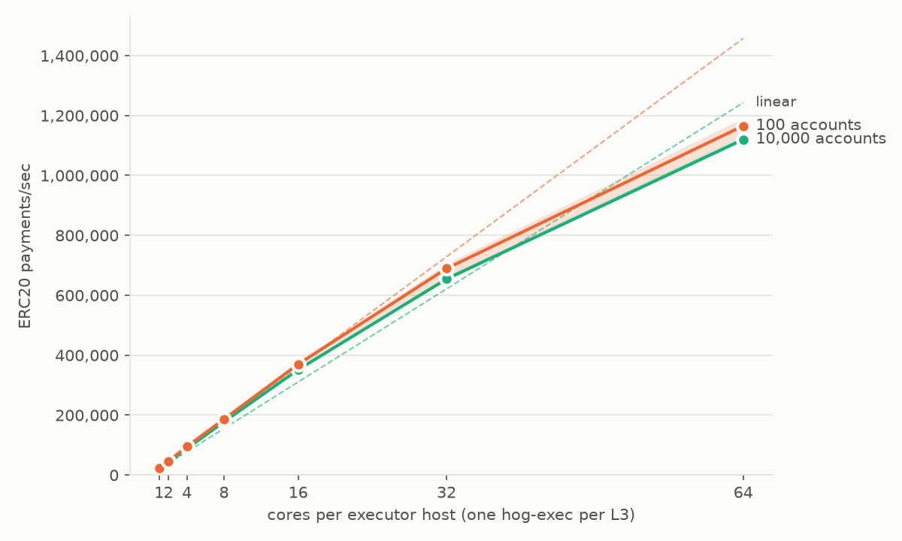
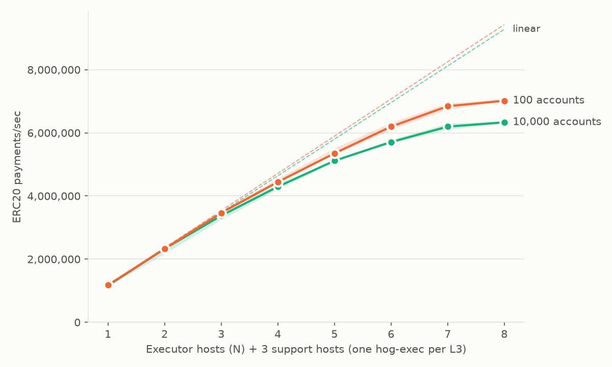
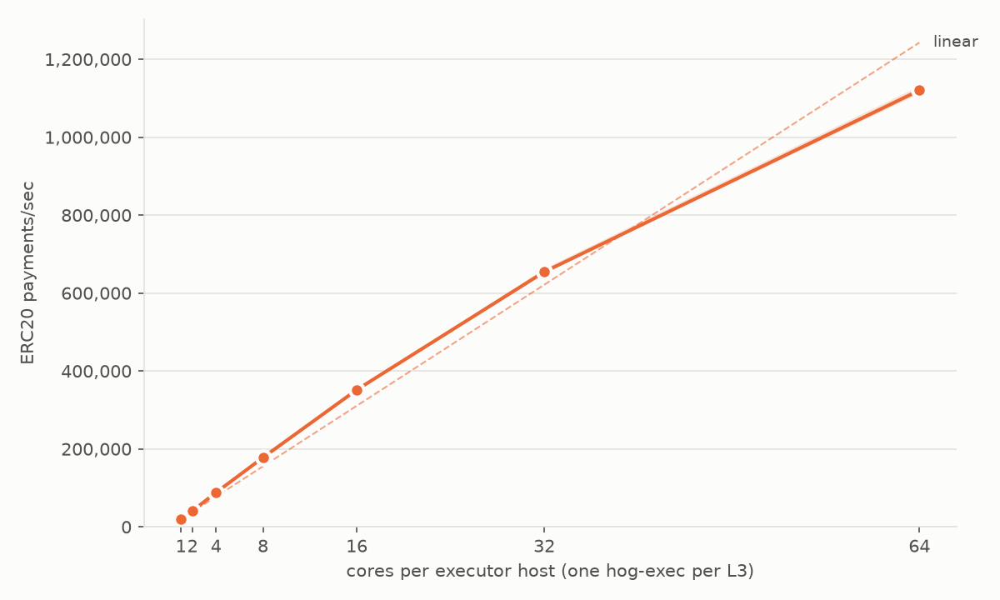
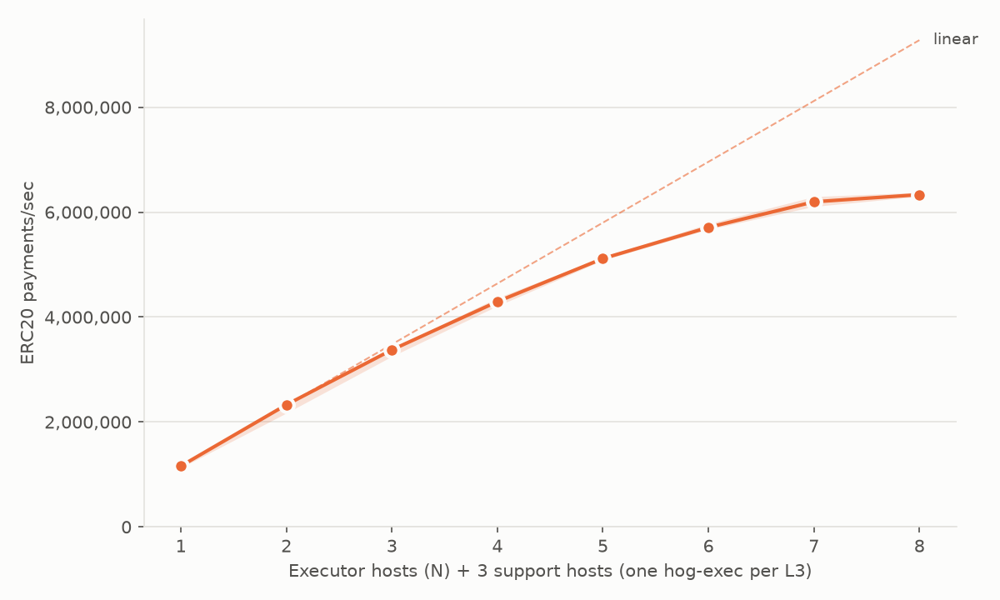

# Published Whitney results

Each section is one sweep or run, copied by `whitney publish`. The summary and chart are made again from the published files.

Left out: sar data, daemon logs, raw metrics (`metrics/`), and `aws.json`. IP addresses, EC2 host names, bucket names, S3 URLs, home paths, ARNs, and SSH key names are replaced with placeholders (`<ip>`, `<host>`, `<bucket>`, `<s3-url>`, `<home>`, `<arn>`, `<key-name>`).

## Compared with 100 accounts

The same archive, scenario, and hosts as `../2026-10-23-executor-scaling/`, with 10,000 sender accounts in place
of 100. Each dashed line is linear scaling from that scenario's own smallest point.

## 20261023-2044-exec-cores-l3-wide-ccd62c951-sweep

- Scenario: `exec-cores-l3-wide`
- hogd_ref: `ccd62c951`
- hogd_commit: `ccd62c95139acbfcc54da1e55ed87ba033d9c21c`
- whitney_commit: `117b9b2d327eeb255c33256874f6a975086cafe7`
- Archive SHA-256: `146d1330859ea2355e841bec36135de0414a6d97020970ce470b6b1236904fa6`
- Instance types: `runner r8a.16xlarge, exec r8a.16xlarge, db r8a.16xlarge, event r8a.16xlarge`
- Storage: `tmpfs`
- exec_allocator: `jemalloc`
- exec_per_l3: `true`
- exec_cores: `[1, 2, 4, 8, 16, 32, 64]`
- n_list: `[1]`
- repetitions: `3`
- Runs: 21 ok, 0 failed

Summary at batch size 5 (`20261023-2044-exec-cores-l3-wide-ccd62c951-sweep/summary-b5.md`):

| storage | n | exec_cores | procs_per_host | indexer | single_host | block_txs | median_block_ms | median_tps | min_tps | max_tps | block_min_tps | block_max_tps | median_exec_tps | median_open_ms | median_close_ms | median_runner_cores | per_rep_median | samples | failed_runs | invalid_runs |
|---|---|---|---|---|---|---|---|---|---|---|---|---|---|---|---|---|---|---|---|---|
| tmpfs | 1 | 1 | 1 | false | false | 29000 | 1497.6 | 19418.4 | 19257.0 | 19427.8 | 18862.0 | 20070.7 | 19610.0 | 0.6 | 14.6 | 0.12 | r1=19427.8;r2=19257.0;r3=19418.4 | 30 | 0 | 0 |
| tmpfs | 1 | 2 | 1 | false | false | 58000 | 1402.8 | 41484.2 | 41015.7 | 41670.8 | 40630.9 | 42104.1 | 41896.0 | 0.6 | 14.0 | 0.30 | r1=41484.2;r2=41015.7;r3=41670.8 | 30 | 0 | 0 |
| tmpfs | 1 | 4 | 1 | false | false | 116000 | 1313.8 | 88156.6 | 87857.9 | 89071.5 | 87210.9 | 89538.5 | 89208.6 | 0.5 | 14.5 | 0.57 | r1=87857.9;r2=89071.5;r3=88156.6 | 30 | 0 | 0 |
| tmpfs | 1 | 8 | 1 | false | false | 232000 | 1304.9 | 177810.3 | 174977.6 | 178357.3 | 174649.2 | 179067.8 | 179646.5 | 0.6 | 13.5 | 0.89 | r1=174977.6;r2=177810.3;r3=178357.3 | 30 | 0 | 0 |
| tmpfs | 1 | 16 | 2 | false | false | 464000 | 1321.2 | 351684.7 | 349651.8 | 351875.5 | 348297.0 | 353525.2 | 356484.6 | 0.8 | 17.2 | 1.63 | r1=351684.7;r2=349651.8;r3=351875.5 | 30 | 0 | 0 |
| tmpfs | 1 | 32 | 4 | false | false | 928000 | 1415.5 | 654350.7 | 653351.0 | 663755.4 | 645624.3 | 664895.1 | 665055.8 | 0.9 | 20.6 | 2.95 | r1=663755.4;r2=654350.7;r3=653351.0 | 30 | 0 | 0 |
| tmpfs | 1 | 64 | 8 | false | false | 1856000 | 1656.8 | 1120242.0 | 1113395.1 | 1132310.8 | 1099168.2 | 1136736.9 | 1138250.8 | 1.0 | 21.7 | 4.75 | r1=1120242.0;r2=1132310.8;r3=1113395.1 | 30 | 0 | 0 |

Left out of each of the 21 runs: `aws.json`, `daemon-logs/`, `metrics/`, `sar/`.

## 20261023-exec-scaling-l3-wide-ccd62c951-sweep

- Scenario: `exec-scaling-l3-wide`
- hogd_ref: `ccd62c951`
- hogd_commit: `ccd62c95139acbfcc54da1e55ed87ba033d9c21c`
- whitney_commit: `117b9b2d327eeb255c33256874f6a975086cafe7`
- Archive SHA-256: `146d1330859ea2355e841bec36135de0414a6d97020970ce470b6b1236904fa6`
- Instance types: `runner r8a.24xlarge, exec r8a.16xlarge, db r8a.24xlarge, event r8a.24xlarge`
- Storage: `tmpfs`
- exec_allocator: `jemalloc`
- exec_per_l3: `true`
- exec_cores: `[64]`
- n_list: `[1, 2, 3, 4, 5, 6, 7, 8]`
- repetitions: `3`, `1`
- Runs: 24 ok, 0 failed
- Note: this sweep joins two sweeps with the same archive and scenario. Repetitions 1 and 2 come from the first sweep (us-west-2c), whose repetition 3 failed on EC2 capacity. Repetition 3 ran as a second sweep with `repetitions = 1` (us-west-2b) and is renamed `-r3` here. `sweep.json` has a `note` that says the same.

Summary at batch size 5 (`20261023-exec-scaling-l3-wide-ccd62c951-sweep/summary-b5.md`):

| storage | n | exec_cores | procs_per_host | indexer | single_host | block_txs | median_block_ms | median_tps | min_tps | max_tps | block_min_tps | block_max_tps | median_exec_tps | median_open_ms | median_close_ms | median_runner_cores | per_rep_median | samples | failed_runs | invalid_runs |
|---|---|---|---|---|---|---|---|---|---|---|---|---|---|---|---|---|---|---|---|---|
| tmpfs | 1 | 64 | 8 | false | false | 4000000 | 3448.7 | 1159842.8 | 1126795.8 | 1171946.2 | 1121490.9 | 1177666.8 | 1172116.5 | 1.1 | 33.7 | 4.90 | r1=1126795.8;r2=1171946.2;r3=1159842.8 | 30 | 0 | 0 |
| tmpfs | 2 | 64 | 8 | false | false | 4000000 | 1720.0 | 2327994.1 | 2169961.0 | 2338404.8 | 2160670.3 | 2348809.3 | 2375768.8 | 1.4 | 34.1 | 7.44 | r1=2169961.0;r2=2338404.8;r3=2327994.1 | 30 | 0 | 0 |
| tmpfs | 3 | 64 | 8 | false | false | 4000000 | 1185.2 | 3375022.9 | 3250386.1 | 3401876.1 | 3228482.9 | 3425634.4 | 3476605.7 | 2.2 | 34.2 | 9.97 | r1=3250386.1;r2=3401876.1;r3=3375022.9 | 30 | 0 | 0 |
| tmpfs | 4 | 64 | 8 | false | false | 4000000 | 931.5 | 4294096.3 | 4211586.3 | 4366755.2 | 4177993.9 | 4414171.5 | 4455925.6 | 2.7 | 31.4 | 13.15 | r1=4211586.3;r2=4294096.3;r3=4366755.2 | 30 | 0 | 0 |
| tmpfs | 5 | 64 | 8 | false | false | 4000000 | 781.5 | 5115178.8 | 5084046.8 | 5141957.4 | 4989216.5 | 5174652.3 | 5353492.2 | 3.2 | 32.0 | 16.34 | r1=5084046.8;r2=5115178.8;r3=5141957.4 | 30 | 0 | 0 |
| tmpfs | 6 | 64 | 8 | false | false | 4000000 | 699.8 | 5709005.2 | 5671452.9 | 5777675.6 | 5602257.3 | 5865992.1 | 6050963.4 | 3.8 | 32.8 | 18.85 | r1=5709005.2;r2=5671452.9;r3=5777675.6 | 30 | 0 | 0 |
| tmpfs | 7 | 64 | 8 | false | false | 4000000 | 642.5 | 6196532.2 | 6107747.5 | 6296204.8 | 4938166.4 | 6379743.5 | 6586872.9 | 4.2 | 33.2 | 21.67 | r1=6107747.5;r2=6296204.8;r3=6196532.2 | 30 | 0 | 0 |
| tmpfs | 8 | 64 | 8 | false | false | 4000000 | 631.6 | 6333348.4 | 6301128.7 | 6375598.9 | 4910401.9 | 6426169.3 | 6745007.2 | 4.7 | 33.7 | 23.66 | r1=6375598.9;r2=6333348.4;r3=6301128.7 | 30 | 0 | 0 |

Left out of each of the 24 runs: `aws.json`, `daemon-logs/`, `metrics/`.
