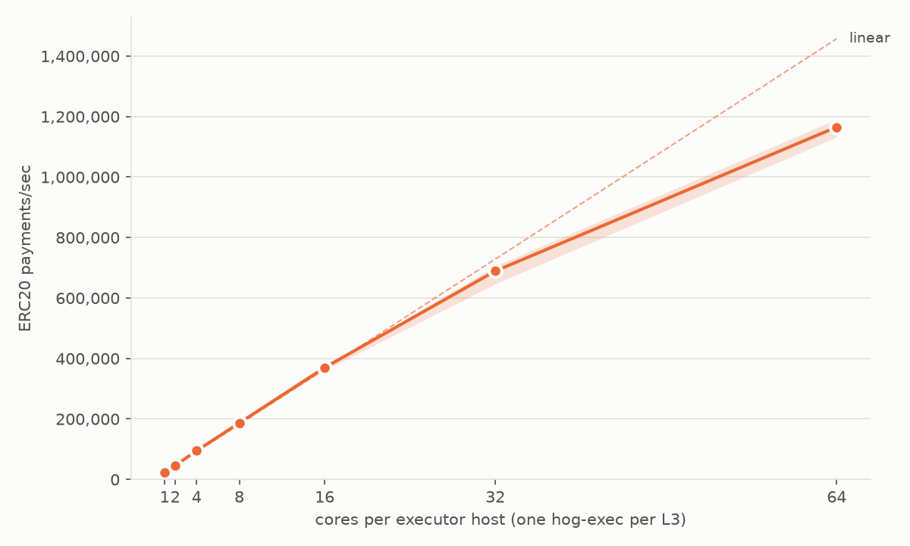
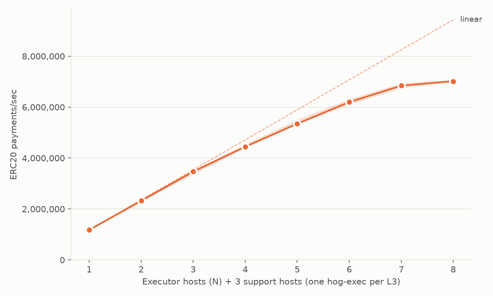

# Published Whitney results

Each section is one sweep or run, copied by `whitney publish`. The summary and chart are made again from the published files.

Left out: sar data, daemon logs, raw metrics (`metrics/`), and `aws.json`. IP addresses, EC2 host names, bucket names, S3 URLs, home paths, ARNs, and SSH key names are replaced with placeholders (`<ip>`, `<host>`, `<bucket>`, `<s3-url>`, `<home>`, `<arn>`, `<key-name>`).

## 20261023-1755-exec-cores-l3-ccd62c951-sweep

- Scenario: `exec-cores-l3`
- hogd_ref: `ccd62c951`
- hogd_commit: `ccd62c95139acbfcc54da1e55ed87ba033d9c21c`
- whitney_commit: `117b9b2d327eeb255c33256874f6a975086cafe7`
- Archive SHA-256: `146d1330859ea2355e841bec36135de0414a6d97020970ce470b6b1236904fa6`
- Instance types: `runner r8a.16xlarge, exec r8a.16xlarge, db r8a.16xlarge, event r8a.16xlarge`
- Storage: `tmpfs`
- exec_allocator: `jemalloc`
- exec_per_l3: `true`
- exec_cores: `[1, 2, 4, 8, 16, 32, 64]`
- n_list: `[1]`
- repetitions: `3`
- Runs: 21 ok, 0 failed

Summary at batch size 5 (`20261023-1755-exec-cores-l3-ccd62c951-sweep/summary-b5.md`):

| storage | n | exec_cores | procs_per_host | indexer | single_host | block_txs | median_block_ms | median_tps | min_tps | max_tps | block_min_tps | block_max_tps | median_exec_tps | median_open_ms | median_close_ms | median_runner_cores | per_rep_median | samples | failed_runs | invalid_runs |
|---|---|---|---|---|---|---|---|---|---|---|---|---|---|---|---|---|---|---|---|---|
| tmpfs | 1 | 1 | 1 | false | false | 29000 | 1273.7 | 22769.0 | 22079.8 | 24227.6 | 21415.5 | 24838.4 | 22858.6 | 0.5 | 4.2 | 0.05 | r1=24227.6;r2=22079.8;r3=22769.0 | 30 | 0 | 0 |
| tmpfs | 1 | 2 | 1 | false | false | 58000 | 1255.9 | 46311.6 | 46093.5 | 46368.7 | 45579.9 | 46856.4 | 46482.6 | 0.5 | 4.4 | 0.28 | r1=46311.6;r2=46093.5;r3=46368.7 | 30 | 0 | 0 |
| tmpfs | 1 | 4 | 1 | false | false | 116000 | 1220.2 | 95061.7 | 94403.7 | 96025.1 | 93983.6 | 96464.8 | 95472.6 | 0.5 | 4.9 | 0.63 | r1=96025.1;r2=94403.7;r3=95061.7 | 30 | 0 | 0 |
| tmpfs | 1 | 8 | 1 | false | false | 232000 | 1243.0 | 186579.0 | 185302.8 | 187480.3 | 184029.7 | 188096.7 | 187528.1 | 0.5 | 6.1 | 0.93 | r1=186579.0;r2=185302.8;r3=187480.3 | 30 | 0 | 0 |
| tmpfs | 1 | 16 | 2 | false | false | 464000 | 1255.1 | 369894.8 | 360382.8 | 371239.2 | 355560.4 | 371850.1 | 372375.8 | 0.8 | 7.3 | 1.73 | r1=360382.8;r2=371239.2;r3=369894.8 | 30 | 0 | 0 |
| tmpfs | 1 | 32 | 4 | false | false | 928000 | 1346.5 | 689177.2 | 646716.4 | 705772.7 | 635060.4 | 707772.4 | 696074.0 | 0.9 | 11.7 | 3.10 | r1=646716.4;r2=689177.2;r3=705772.7 | 30 | 0 | 0 |
| tmpfs | 1 | 64 | 8 | false | false | 1856000 | 1592.7 | 1165321.0 | 1131953.7 | 1191414.1 | 1101473.7 | 1194323.5 | 1182219.5 | 1.0 | 21.6 | 4.79 | r1=1131953.7;r2=1165321.0;r3=1191414.1 | 30 | 0 | 0 |

Left out of each of the 21 runs: `aws.json`, `daemon-logs/`, `metrics/`, `sar/`.

## 20261023-exec-scaling-l3-ccd62c951-sweep

- Scenario: `exec-scaling-l3`
- hogd_ref: `ccd62c951`
- hogd_commit: `ccd62c95139acbfcc54da1e55ed87ba033d9c21c`
- whitney_commit: `117b9b2d327eeb255c33256874f6a975086cafe7`
- Archive SHA-256: `146d1330859ea2355e841bec36135de0414a6d97020970ce470b6b1236904fa6`
- Instance types: `runner r8a.24xlarge, exec r8a.16xlarge, db r8a.24xlarge, event r8a.24xlarge`
- Storage: `tmpfs`
- exec_allocator: `jemalloc`
- exec_per_l3: `true`
- exec_cores: `[64]`
- n_list: `[1, 2, 3, 4, 5, 6, 7, 8]`
- repetitions: `3`, `1`
- Runs: 24 ok, 0 failed
- Note: this sweep joins two sweeps with the same archive and scenario. Repetitions 1 and 2 come from the first sweep, which stopped after repetition 2 because the operator's AWS session expired. Repetition 3 ran as a second sweep with `repetitions = 1` and is renamed `-r3` here. `sweep.json` has a `note` that says the same.

Summary at batch size 5 (`20261023-exec-scaling-l3-ccd62c951-sweep/summary-b5.md`):

| storage | n | exec_cores | procs_per_host | indexer | single_host | block_txs | median_block_ms | median_tps | min_tps | max_tps | block_min_tps | block_max_tps | median_exec_tps | median_open_ms | median_close_ms | median_runner_cores | per_rep_median | samples | failed_runs | invalid_runs |
|---|---|---|---|---|---|---|---|---|---|---|---|---|---|---|---|---|---|---|---|---|
| tmpfs | 1 | 64 | 8 | false | false | 4000000 | 3393.5 | 1178687.8 | 1176837.1 | 1181456.8 | 1173879.8 | 1186632.4 | 1189133.3 | 1.1 | 29.9 | 4.89 | r1=1178687.8;r2=1176837.1;r3=1181456.8 | 30 | 0 | 0 |
| tmpfs | 2 | 64 | 8 | false | false | 4000000 | 1723.0 | 2321152.4 | 2318650.6 | 2413663.1 | 2312457.4 | 2417766.2 | 2368446.8 | 1.4 | 33.3 | 7.61 | r1=2321152.4;r2=2318650.6;r3=2413663.1 | 30 | 0 | 0 |
| tmpfs | 3 | 64 | 8 | false | false | 4000000 | 1153.8 | 3466747.0 | 3345419.9 | 3527610.8 | 3331253.2 | 3547466.3 | 3583928.3 | 2.1 | 35.6 | 10.27 | r1=3466747.0;r2=3345419.9;r3=3527610.8 | 30 | 0 | 0 |
| tmpfs | 4 | 64 | 8 | false | false | 4000000 | 899.9 | 4444128.4 | 4413544.9 | 4552699.4 | 4393287.3 | 4584847.0 | 4645274.2 | 2.7 | 34.3 | 13.03 | r1=4444128.4;r2=4413544.9;r3=4552699.4 | 30 | 0 | 0 |
| tmpfs | 5 | 64 | 8 | false | false | 4000000 | 747.8 | 5349218.3 | 5317483.2 | 5514298.5 | 5294279.4 | 5571739.4 | 5656999.2 | 3.2 | 37.3 | 16.23 | r1=5349218.3;r2=5317483.2;r3=5514298.5 | 30 | 0 | 0 |
| tmpfs | 6 | 64 | 8 | false | false | 4000000 | 645.5 | 6196705.5 | 6099708.6 | 6325419.4 | 6068753.0 | 6399843.3 | 6575749.7 | 3.8 | 33.7 | 19.51 | r1=6196705.5;r2=6099708.6;r3=6325419.4 | 30 | 0 | 0 |
| tmpfs | 7 | 64 | 8 | false | false | 4000000 | 585.8 | 6843129.7 | 6739991.9 | 6935872.9 | 6688794.1 | 7053393.3 | 7298395.7 | 4.3 | 32.2 | 22.96 | r1=6843129.7;r2=6739991.9;r3=6935872.9 | 30 | 0 | 0 |
| tmpfs | 8 | 64 | 8 | false | false | 4000000 | 569.6 | 7016546.2 | 7007379.8 | 7084125.1 | 6692187.8 | 7187763.2 | 7544267.8 | 4.7 | 36.1 | 25.39 | r1=7007379.8;r2=7016546.2;r3=7084125.1 | 30 | 0 | 0 |

Left out of each of the 24 runs: `aws.json`, `daemon-logs/`, `metrics/`.
